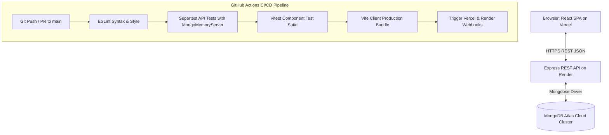

# MERN Stack CI/CD Task Manager

[](https://github.com/placeholder-user/mern-cicd-task-manager/actions/workflows/ci-cd.yml)
[](https://nodejs.org/)
[](https://react.dev/)
[](LICENSE)

An enterprise-grade, full-stack Task Management Application built using the **MongoDB, Express.js, React.js, and Node.js (MERN)** stack, featuring an automated **Continuous Integration and Continuous Deployment (CI/CD)** pipeline powered by GitHub Actions.

Designed and engineered for a final-year B.Tech Computer Science & Engineering capstone portfolio, technical demonstrations, and production cloud environments.

---

## Live Links & Placeholders

- **Live Frontend (Vercel)**: `https://<YOUR_VERCEL_PROJECT>.vercel.app` *(Replace with your live URL upon deployment)*
- **Backend API Health Check (Render)**: `https://<YOUR_RENDER_SERVICE>.onrender.com/api/health` *(Replace with your live URL upon deployment)*
- **GitHub Repository**: `https://github.com/<YOUR_GITHUB_USERNAME>/mern-cicd-task-manager`
- **Demonstration Video**: `https://drive.google.com/file/d/<YOUR_FILE_ID>/view?usp=sharing` *(Follow [DEMO_RECORDING_GUIDE.md](file:///c:/Users/chand/Desktop/mern-cicd-task-manager/DEMO_RECORDING_GUIDE.md))*

---

## Table of Contents
1. [Project Overview](#1-project-overview)
2. [Problem Statement](#2-problem-statement)
3. [Objectives](#3-objectives)
4. [Key Features](#4-key-features)
5. [Technology Stack](#5-technology-stack)
6. [Architecture & Data Flow](#6-architecture--data-flow)
7. [Repository Structure](#7-repository-structure)
8. [Prerequisites](#8-prerequisites)
9. [Local Installation Guide](#9-local-installation-guide)
10. [Environment Variables](#10-environment-variables)
11. [Database Configuration (Local & MongoDB Atlas)](#11-database-configuration-local--mongodb-atlas)
12. [Running Locally](#12-running-locally)
13. [API Documentation](#13-api-documentation)
14. [Automated Testing Suite](#14-automated-testing-suite)
15. [CI/CD Pipeline with GitHub Actions](#15-cicd-pipeline-with-github-actions)
16. [Production Deployment Guide (Vercel & Render)](#16-production-deployment-guide-vercel--render)
17. [Troubleshooting & Diagnostics](#17-troubleshooting--diagnostics)
18. [Security & Production Best Practices](#18-security--production-best-practices)
19. [Screenshots](#19-screenshots)
20. [Learning Outcomes](#20-learning-outcomes)

---

## 1. Project Overview
The **MERN CI/CD Task Manager** is a full-stack web application that allows users to create, view, update, prioritize, filter, and track task statuses in real time. Beyond core CRUD operations, the project demonstrates modern engineering practices including clean architectural layering, comprehensive automated testing (unit, integration, and component testing), code quality enforcement through ESLint, and a fully automated GitHub Actions pipeline that validates every pull request and push prior to deployment.

---

## 2. Problem Statement
In traditional software development curricula, students often create standalone full-stack applications without adopting DevOps practices, automated testing, or continuous deployment pipelines. When code is manually deployed, teams face integration drift, runtime production failures, unverified dependencies, and configuration regressions.

This project solves this gap by demonstrating how modern agile teams integrate continuous testing, linting, build verification, and deployment orchestration directly into the Git workflow from day one.

---

## 3. Objectives
1. **Full-Stack Mastery**: Implement a responsive React single-page frontend consuming a decoupled Node.js Express REST API.
2. **Database Integration**: Model persistent data schemas in MongoDB using Mongoose with validation and indexing.
3. **Automated Testing**: Achieve high test coverage with isolated backend integration tests (Supertest + In-Memory MongoDB) and frontend component tests (Vitest + React Testing Library).
4. **Continuous Integration**: Implement GitHub Actions workflows that trigger on pull requests and pushes, catching regressions automatically.
5. **Continuous Deployment**: Configure zero-downtime cloud hosting using Vercel (Client) and Render (Server) with isolated environment management.
6. **Security & Production Readiness**: Enforce CORS origin constraints, sanitize payloads, prevent stack trace leaks, and manage credentials securely.

---

## 4. Key Features

### Frontend (Client)
- **High-End UI/UX**: Professional dark-slate theme with glassmorphism cards, micro-animations, and modern typography (Outfit & Inter).
- **Dynamic Task Statistics**: Real-time counter for Total Tasks, Pending Tasks, Completed Tasks, and completion percentage.
- **Task Management**: Create tasks with titles, descriptions, priority levels (Low, Medium, High), and due dates.
- **Fast Status Toggle**: Instant status toggling between completed and pending with optimistic UI updates.
- **Search & Filtering**: Search tasks by keywords in title or description; filter by status and priority simultaneously.
- **Overdue Indicator**: Visual badge for tasks that have passed their target deadline.
- **Validation & Modals**: Client-side form validation, modal dialogues for editing, and confirmation modal before deletions.
- **Live System Connectivity Monitor**: Real-time indicator displaying whether the backend API is reachable.
- **Toast Notifications**: Non-intrusive feedback toasts for all user actions.

### Backend (Server)
- **Modular REST API**: Layered architecture separating routes, controllers, middleware, and models.
- **Strict Validation**: Input sanitization and payload validation before reaching the database layer.
- **Centralized Error Handling**: Handles bad ObjectIDs, validation failures, syntax errors, and missing resources uniformly.
- **Zero-Credential Health Endpoint**: `/api/health` reports uptime and database status without leaking secrets.
- **Safe Production Responses**: Omits internal stack traces when running in production mode.

---

## 5. Technology Stack

| Layer | Technology | Purpose |
|---|---|---|
| **Frontend Framework** | React 18+ | Declarative component-based user interface |
| **Frontend Build Tool** | Vite | Rapid development server and optimized rollup production bundling |
| **Frontend Styling** | Modern Vanilla CSS | Custom design system tokens, responsive grid/flexbox, glassmorphism |
| **Backend Runtime** | Node.js (v20+ LTS) | Asynchronous event-driven server runtime |
| **Backend Framework** | Express.js 4.x | REST API routing and middleware pipeline |
| **Database ODM** | Mongoose 8.x | Schema validation and MongoDB object modeling |
| **Database** | MongoDB / Atlas | Document-oriented cloud database |
| **Frontend Testing** | Vitest & React Testing Library | Component unit testing, DOM simulation, user interactions |
| **Backend Testing** | Supertest & Jest | HTTP integration testing and endpoint verification |
| **In-Memory Database** | `mongodb-memory-server` | Isolated zero-credential test database |
| **Code Quality** | ESLint | Static code analysis and syntax enforcement |
| **CI/CD** | GitHub Actions | Automated build, test, and lint workflow |
| **Client Hosting** | Vercel | Global CDN single page application hosting |
| **Server Hosting** | Render | Managed Node.js cloud web service |

---

## 6. Architecture & Data Flow



---

## 7. Repository Structure

```text
mern-cicd-task-manager/
├── .github/
│   └── workflows/
│       └── ci-cd.yml          # Automated CI/CD pipeline definition
├── client/
│   ├── public/
│   │   └── favicon.svg        # Modern vector application icon
│   ├── src/
│   │   ├── components/
│   │   │   ├── DeleteConfirmModal.jsx
│   │   │   ├── EmptyState.jsx
│   │   │   ├── Navbar.jsx
│   │   │   ├── StatsCards.jsx
│   │   │   ├── TaskFilterBar.jsx
│   │   │   ├── TaskItem.jsx
│   │   │   ├── TaskList.jsx
│   │   │   ├── TaskModal.jsx
│   │   │   └── Toast.jsx
│   │   ├── services/
│   │   │   └── api.js         # Decoupled REST API client wrapper
│   │   ├── tests/
│   │   │   ├── App.test.jsx
│   │   │   ├── StatsCards.test.jsx
│   │   │   └── TaskModal.test.jsx
│   │   ├── App.jsx            # Main dashboard container & state
│   │   ├── index.css          # Core design system & responsive styling
│   │   ├── main.jsx           # React DOM root entrypoint
│   │   └── setupTests.js      # Test environment configuration
│   ├── .env.example           # Client environment template
│   ├── .eslintrc.json         # Client linting rules
│   ├── index.html             # HTML5 shell with Google Fonts
│   ├── package.json           # Client scripts & dependencies
│   ├── vercel.json            # Vercel SPA routing rewrites
│   └── vite.config.js         # Vite & Vitest configuration
├── server/
│   ├── config/
│   │   └── db.js              # Database connection & retry logic
│   ├── controllers/
│   │   ├── healthController.js # Non-leaking health diagnostic controller
│   │   └── taskController.js   # Task CRUD controller logic
│   ├── middleware/
│   │   ├── errorHandler.js    # Centralized 404 & error handling
│   │   └── validateTask.js    # Payload validation middleware
│   ├── models/
│   │   └── Task.js            # Mongoose Task schema
│   ├── routes/
│   │   ├── healthRoutes.js    # /api/health route definition
│   │   └── taskRoutes.js      # /api/tasks route definition
│   ├── tests/
│   │   ├── health.test.js     # Health endpoint integration tests
│   │   ├── setup.js           # In-memory MongoDB lifecycle helper
│   │   └── tasks.test.js      # Comprehensive CRUD & error tests
│   ├── app.js                 # Express application configuration
│   ├── server.js              # Server bootstrapper & graceful shutdown
│   ├── .env.example           # Server environment template
│   ├── .eslintrc.json         # Server linting rules
│   └── package.json           # Server scripts & dependencies
├── .editorconfig              # Code formatting rules
├── .gitignore                 # Exclusion rules for secrets, builds, and node_modules
├── DEMO_RECORDING_GUIDE.md    # 4-6 minute presentation script & recording checklist
├── package.json               # Root orchestration scripts
├── README.md                  # Comprehensive project documentation
└── render.yaml                # Render Blueprint configuration
```

---

## 8. Prerequisites

Ensure the following tools are installed on your workstation:
- **Node.js**: `v20.x` or higher (tested on Node v20 and v24)
- **npm**: `v10.x` or higher
- **Git**: `v2.x` or higher
- **MongoDB**: Either a local MongoDB instance or a free [MongoDB Atlas](https://www.mongodb.com/atlas) account

Verify installed versions in Windows PowerShell:
```powershell
node -v
npm -v
git --version
```

---

## 9. Local Installation Guide

Clone the repository and install all dependencies:

```powershell
# 1. Clone repository
git clone https://github.com/<YOUR_GITHUB_USERNAME>/mern-cicd-task-manager.git

# 2. Enter workspace root
cd mern-cicd-task-manager

# 3. Install all dependencies across root, server, and client
npm run install:all
```

---

## 10. Environment Variables

Never commit `.env` files. Template files (`.env.example`) are provided with non-sensitive placeholders.

### Backend (`server/.env`)
Create `server/.env` based on `server/.env.example`:

```ini
PORT=5000
NODE_ENV=development
MONGODB_URI=mongodb://127.0.0.1:27017/taskmanager
CLIENT_URL=http://localhost:5173
```

### Frontend (`client/.env`)
Create `client/.env` based on `client/.env.example`:

```ini
VITE_API_URL=http://localhost:5000/api
```

---

## 11. Database Configuration (Local & MongoDB Atlas)

### Option A: Local MongoDB
1. Ensure the MongoDB service is running on your machine:
   ```powershell
   Get-Service -Name MongoDB*
   ```
2. Set your `MONGODB_URI` in `server/.env`:
   ```ini
   MONGODB_URI=mongodb://127.0.0.1:27017/taskmanager
   ```

### Option B: MongoDB Atlas (Recommended for Cloud & Deployment)
1. Log in to [MongoDB Atlas](https://cloud.mongodb.com/).
2. Create a free **M0 Sandbox** cluster.
3. In **Database Access**, create a user (e.g., `task_user`) with read/write privileges.
4. In **Network Access**, click **Add IP Address** -> Select **Allow Access from Anywhere (`0.0.0.0/0`)** for cloud hosting access.
5. In **Database** -> Click **Connect** -> Choose **Drivers** (Node.js).
6. Copy the connection string and paste it into `server/.env`:
   ```ini
   MONGODB_URI=mongodb+srv://<username>:<password>@cluster0.mongodb.net/taskmanager?retryWrites=true&w=majority
   ```

---

## 12. Running Locally

Execute commands from the workspace root in Windows PowerShell:

```powershell
# Run both Frontend and Backend concurrently with colored output
npm run dev

# Or run services individually:
npm run dev:server   # Starts Express backend on http://localhost:5000
npm run dev:client   # Starts Vite frontend on http://localhost:5173
```

Open your browser to [http://localhost:5173](http://localhost:5173).

---

## 13. API Documentation

Base URL: `/api`

### Health Endpoint
| Method | Endpoint | Description | Response Status |
|---|---|---|---|
| `GET` | `/api/health` | Returns server health, uptime, and database connectivity. | `200 OK` |

#### Sample Health Response:
```json
{
  "success": true,
  "status": "healthy",
  "timestamp": "2026-10-29T06:17:45.000Z",
  "uptime": 128,
  "environment": "development",
  "database": {
    "status": "connected",
    "connected": true
  }
}
```

### Task Endpoints
| Method | Endpoint | Description | Request Body | Response Status |
|---|---|---|---|---|
| `GET` | `/api/tasks` | Retrieve all tasks (supports `?status=`, `?priority=`, `?search=`) | None | `200 OK` |
| `GET` | `/api/tasks/:id` | Retrieve single task by MongoDB ID | None | `200 OK` / `404 Not Found` |
| `POST` | `/api/tasks` | Create a new task with validation | `{ title, description?, priority?, dueDate? }` | `201 Created` / `400 Bad Request` |
| `PUT` | `/api/tasks/:id` | Update task details | `{ title?, description?, priority?, status?, dueDate? }` | `200 OK` / `404 Not Found` |
| `PATCH` | `/api/tasks/:id/status` | Update task status only | `{ status: "pending" | "completed" }` | `200 OK` / `400 Bad Request` |
| `DELETE`| `/api/tasks/:id` | Delete a task by ID | None | `200 OK` / `404 Not Found` |

---

## 14. Automated Testing Suite

The project includes 36 automated tests across backend and frontend suites. Tests do not require real database credentials; backend tests use an isolated in-memory MongoDB server.

```powershell
# Run all tests (Server + Client)
npm test

# Run backend API tests only (Supertest & Jest)
npm run test:server

# Run frontend tests only (Vitest & React Testing Library)
npm run test:client

# Run static code analysis (ESLint)
npm run lint
```

### Test Coverage Highlights
- **Backend**:
  - `health.test.js`: Verifies status 200, uptime, database check, credential non-leakage, and 404 handler.
  - `tasks.test.js`: Validates task creation, default fields, validation errors (short title, bad priority, bad status), filtering, keyword search, invalid ObjectID rejection, updates, status patch, and deletions.
- **Frontend**:
  - `StatsCards.test.jsx`: Validates task count calculations and completion rate percentages.
  - `TaskModal.test.jsx`: Validates required fields, character length errors, form submission, and pre-filling on edit.
  - `App.test.jsx`: Validates dashboard mounting, API health checks, rendering task lists, and network error handling.

---

## 15. CI/CD Pipeline with GitHub Actions

The workflow is defined in [`.github/workflows/ci-cd.yml`](file:///c:/Users/chand/Desktop/mern-cicd-task-manager/.github/workflows/ci-cd.yml).

### Pipeline Workflow Stages
1. **Trigger Events**:
   - `push` to `main`, `feature/**`, or `fix/**`.
   - `pull_request` targeting `main`.
2. **Stage 1: Lint & Code Quality**:
   - Checks out code with `actions/checkout@v4`.
   - Configures Node 20 LTS with caching.
   - Executes ESLint on backend and frontend codebases.
3. **Stage 2: Backend Integration Tests**:
   - Installs server dependencies using clean lockfile (`npm ci`).
   - Runs Jest and Supertest against an in-memory MongoDB database.
4. **Stage 3: Frontend Tests & Production Build**:
   - Executes Vitest component test suites.
   - Bundles the Vite production assets to confirm build integrity.
5. **Stage 4: Deployment Trigger (Main branch only)**:
   - Executes only upon successful completion of all prior jobs.
   - Emits deployment verification logs and triggers webhooks securely.

---

## 16. Production Deployment Guide (Vercel & Render)

### Frontend Deployment: Vercel
1. Go to [Vercel](https://vercel.com/) and connect your GitHub account.
2. Click **Add New...** -> **Project** -> Import `mern-cicd-task-manager`.
3. In **Root Directory**, click **Edit** and select `client`.
4. Build Framework will auto-detect as **Vite**.
5. Under **Environment Variables**, add:
   - `VITE_API_URL`: Your deployed Render backend URL (e.g., `https://mern-task-manager-api.onrender.com/api`).
6. Click **Deploy**. Vercel will build and assign a global production URL.

### Backend Deployment: Render
1. Go to [Render](https://render.com/) and connect your GitHub account.
2. Click **New +** -> **Web Service**.
3. Connect your repository.
4. Configure service settings:
   - **Root Directory**: `server`
   - **Environment**: `Node`
   - **Build Command**: `npm install --omit=dev`
   - **Start Command**: `npm start`
5. In **Environment Variables**, add:
   - `NODE_ENV`: `production`
   - `PORT`: `10000`
   - `MONGODB_URI`: Your MongoDB Atlas connection string.
   - `CLIENT_URL`: Your Vercel frontend URL (e.g., `https://mern-cicd-task-manager.vercel.app`).
6. Click **Create Web Service**.

---

## 17. Troubleshooting & Diagnostics

| Symptom | Cause | Solution |
|---|---|---|
| Frontend shows "Connecting..." status | Backend API is offline or CORS is blocking requests | Verify server is running on port 5000 and `CLIENT_URL` matches frontend port. |
| Backend fails on startup with `CRITICAL CONFIGURATION ERROR` | Missing `MONGODB_URI` environment variable | Ensure `server/.env` exists and contains a valid MongoDB connection string. |
| Tests fail with port conflict | Server is already listening on port 5000 | Tests use `supertest(app)` without opening socket ports. Stop any background Node servers. |
| Vercel direct route reload returns 404 | SPA client-side routing rewrite missing | Ensure `client/vercel.json` contains `{ "rewrites": [{ "source": "/(.*)", "destination": "/" }] }`. |

---

## 18. Security & Production Best Practices

- **Zero Hardcoded Credentials**: No passwords or connection strings are tracked in Git.
- **Payload Sanitization & Size Limits**: Body parser limited to 10kb to mitigate DoS payload injection.
- **Safe Error Emission**: Internal stack traces are suppressed in production mode.
- **Input Validation**: Strict Mongoose and Express validation filters malicious inputs before reaching the database.
- **Single-User Scope**: This demonstration application is structured as a single-workspace task manager. In enterprise production, multi-tenant authentication (e.g., JWT or OAuth 2.0) should be introduced.

---

## 19. Screenshots

*(Replace placeholders with real application screenshots upon deployment)*

| Dashboard Overview | Task Creation & Edit Modal |
|---|---|
|  |  |

| Filtered View & Status Indicators | GitHub Actions Successful Run |
|---|---|
|  |  |

---

## 20. Learning Outcomes

1. **Full-Stack Competency**: Architected and implemented an end-to-end MERN application with clean modular separation.
2. **Automated Testing**: Designed comprehensive unit, integration, and component testing suites using Jest, Supertest, Vitest, and React Testing Library.
3. **DevOps & CI/CD**: Authored multi-stage GitHub Actions workflows for continuous integration and automated quality gates.
4. **Cloud Deployment**: Gained practical experience deploying decoupled client and server architectures to Vercel, Render, and MongoDB Atlas.
5. **Technical Communication**: Documented project architecture, video recording demonstrations, and deployment guidelines for academic and professional presentation.

---

## License
This project is open-source and available under the [MIT License](LICENSE).
